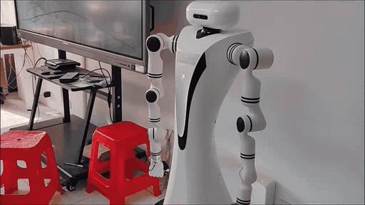
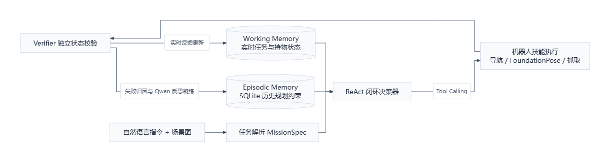

# 面向长时序移动操作任务的具身 Agent 与记忆增强执行框架

**RealMan 移动操作平台 · ReAct · Working Memory · Episodic Memory**

[](https://github.com/fanjiahui-charix/Long_sequence_tasks_for_realmanrobot/actions/workflows/demo.yml) [](pyproject.toml) [](docs/HARDWARE_VALIDATION.md) [](vision_grasp/integration) [](LICENSE)

面向自然语言指令驱动的长时序移动操作任务，构建结合 **ReAct 决策与双层记忆**的具身 Agent 框架。系统根据当前任务状态、环境反馈与历史经验，动态编排导航、目标定位、抓取与返回等机器人技能。

项目以 RealMan 移动操作机器人为载体，集成 RGB-D 感知、YOLO-seg 分割、FoundationPose 6D 位姿估计与机械臂抓取，探索执行反馈如何影响后续决策，以及历史失败如何转化为可复用的规划经验。

[方法概述](#方法概述) · [任务场景](#任务场景) · [ReAct 闭环决策](#react-闭环决策) · [记忆增强](#记忆增强执行机制) · [经验复用示例](#历史经验复用示例) · [运行与文档](#运行与文档)



RealMan 移动操作平台演示 · [观看原速视频](docs/media/project-demo.mp4)

## 方法概述

长时序移动操作需要连续协调多个技能，并处理执行过程中不断变化的机器人与物体状态。本项目将任务执行组织为观察、推理、行动与记忆更新的循环，围绕以下内容展开：

- **基于 ReAct 的闭环决策**：结合任务目标、当前观察与历史经验，逐轮选择技能，并根据执行反馈调整后续步骤。
- **工作记忆与情景记忆协同**：Working Memory 维护实时任务上下文，Episodic Memory 积累历史执行中形成的条件性经验，共同参与当前决策。
- **面向决策的经验凝练**：复盘历史中的前置条件遗漏、动作顺序问题与无效重试，将其总结为适用条件、规划约束和注意事项，供后续任务调用。



## 任务场景

> 从 A 出发，到 B 点桌子上找到黑色眼镜盒，把它拿起并带回 A。

输入为自然语言指令，以及标注 A、B、桌子和目标物体的场景示意图。当前以 **A→B→A 的眼镜盒取回任务**作为标准示例，串联场景理解、跨地点移动、视觉定位和物体抓取。

| 任务环节 | 系统执行的内容 |
| --- | --- |
| 场景与任务理解 | 结合指令和场景图，确定起点、取物位置与目标物体 |
| 导航至目标区域 | 从 A 移动到 B 点的取物区域 |
| 目标定位 | 采集 RGB-D，生成目标 Mask，估计目标 6D 位姿并完成坐标变换 |
| 物体抓取 | 根据定位结果执行预抓取、抓取、夹爪闭合和回撤，读取执行反馈 |
| 携物返回 | 返回 A，并结合机器人与夹爪反馈确认任务结果 |

## ReAct 闭环决策

Agent 在每轮决策前读取任务上下文、最新观察和相关历史经验，选择下一步机器人技能。技能执行后，新的反馈用于更新工作记忆，再进入下一轮决策。

这一过程使技能选择与实际执行状态保持联系。例如，目标定位失效后，Agent 可以先重新定位再继续抓取；前置条件未改善时，可以补充观察或调整步骤，避免机械重复失败动作。

### 机器人技能编排

通过结构化 Tool Calling，将任务层的决策连接到导航、视觉和机械臂操作：

| Skill | 机器人能力 |
| --- | --- |
| `navigate_to` | 调用底盘导航，移动至任务指定位置 |
| `locate_object` | RGB-D 采集 → YOLO-seg Mask → FoundationPose 6D 位姿估计 → 相机到机械臂基座坐标变换 |
| `grasp_object` | 根据当前定位结果执行预抓取、抓取、夹爪闭合与回撤 |
| `observe_robot_state` | 获取导航、机械臂和夹爪反馈，为下一轮决策更新状态 |

## 记忆增强执行机制

框架采用**工作记忆（Working Memory）**与**情景记忆（Episodic Memory）**：前者维护当前任务的状态与进展，后者提供在相似情境下可借鉴的规划约束。两类记忆共同构成每轮 ReAct 决策的上下文。

以下 JSON 为精简展示，完整记录见 [演示输出](examples/memory_demo.json)。

<table>
<tr>
<th width="50%">Working Memory · 当前任务上下文</th>
<th width="50%">Episodic Memory · 历史规划经验</th>
</tr>
<tr>
<td valign="top">
<p>记录任务进度、机器人位置、物体定位、持物状态与最新反馈，随执行过程更新。</p>
<pre lang="json">{
  "mission_status": "RUNNING",
  "current_location": "B",
  "pose": null,
  "grasp_state": "NOT_HELD",
  "last_error": null
}</pre>
</td>
<td valign="top">
<p>从历史决策与执行反馈中凝练适用条件、决策问题、规划约束、经验及注意事项。</p>
<pre lang="json">{
  "applicability":
    "到达目标区域后，当前没有有效位姿",
  "decision_issue":
    "前置条件未改善时反复提出抓取",
  "planning_constraints": [
    "先取得本轮有效位姿，再安排抓取",
    "前置条件未改善时，不机械重试"
  ],
  "lesson":
    "利用反馈补齐条件，再决定下一步",
  "precautions": [
    "状态不明先观察，避免重复无效动作"
  ]
}</pre>
</td>
</tr>
</table>

### 经验凝练与复用

在恢复完成或任务结束后，模型结合历史决策、当时状态、失败反馈与后续过程进行复盘，识别规划中遗漏的条件与检查，总结下一次遇到相似情境时应如何调整决策。凝练后的经验保存到 SQLite，随任务执行逐步积累。

新任务开始或执行失败时，系统按任务类型、Skill、失败情境和物体类别检索相关经验，将其与当前 Working Memory 一起注入 ReAct 上下文。历史经验为本轮规划提供条件性约束，当前任务事实则随实时反馈更新。

## 历史经验复用示例

以下案例展示从历史失败形成经验，再将经验用于后续任务的过程：

| 阶段 | 演示过程 |
| --- | --- |
| **历史失败** | 在前置条件缺失的故障注入场景中，历史策略到达 B 后反复提出抓取；系统记录各轮决策、状态与失败反馈。 |
| **经验反思** | Qwen 复盘上述过程，形成“先取得有效位姿”“前置条件未改善时不机械重试”等规划约束、经验和注意事项。 |
| **经验积累** | 将总结保存到 SQLite；新的任务重新读取数据库，检索并注入相关历史约束。 |
| **后续决策** | 当新任务位于 B、当前位姿为空时，实际选择 `locate_object`，随后继续抓取并携物返回。 |

[完整 JSON](examples/memory_demo.json) 包含历史决策、经验总结、实际注入内容与后续动作，可对照观察两类 Memory 如何共同参与决策。[演示脚本](examples/reflection_demo.py) 支持离线运行与 Qwen API 调用。

该基准采用可复现的前置条件缺失场景，由 Mock Backend 提供机器人状态，`qwen-plus` API 生成经验反思和后续决策，用于检查经验凝练、持久化与跨任务复用。

## 运行与文档

在独立的 Python 3.10+ 环境中安装并运行：

```bash
git clone https://github.com/fanjiahui-charix/Long_sequence_tasks_for_realmanrobot.git
cd Long_sequence_tasks_for_realmanrobot
python -m pip install -e .

# 离线运行完整取物任务
python -m robot_agent demo --memory

# 演示历史失败反思与跨任务经验复用
python examples/reflection_demo.py --output-dir runtime/reflection
```

配置 Qwen API 后，可使用自然语言与场景图运行任务，或由真实模型完成经验反思与后续决策。安装步骤、模型配置与硬件接入说明见下列文档。

| 文档 | 内容 |
| --- | --- |
| [运行与复现](docs/QUICKSTART.md) | 环境安装、Qwen API、完整任务与经验复用演示 |
| [系统设计](docs/SYSTEM_DESIGN.md) | ReAct 决策、Memory 与任务执行机制 |
| [机器人接口](docs/BACKEND_API.md) | 导航、视觉、抓取与反馈接口 |
| [硬件接入](docs/HARDWARE_VALIDATION.md) | 平台适配、反馈标定与部署检查 |

代码入口：[ReAct 决策](robot_agent/agent.py) · [Working Memory](robot_agent/state.py) · [Episodic Memory](robot_agent/memory/episodic.py) · [经验凝练](robot_agent/memory/consolidation.py) · [机器人适配](robot_agent/adapters)

### 仓库代码导航

```text
robot_agent/                 # Agent 决策、记忆与技能调用
navigation/                  # 底盘导航及 ROS 衔接
vision_grasp/integration/    # 视觉定位流程集成
vision_grasp/grasp/          # 机械臂抓取执行
vision_grasp/foundationpose/ # FoundationPose 算法及适配
vision_grasp/ros_packages/   # 机器人 ROS 驱动与消息包
examples/                   # 任务输入、经验复用脚本和结果
docs/                       # 设计、接口与部署文档
```

机器人集成代码与内置的算法、驱动分别放置；第三方组件授权见 [NOTICE](NOTICE.md)。

## License

Agent 实现采用 [MIT License](LICENSE)。集成的 FoundationPose、ROS 驱动及媒体保留原有授权，见 [NOTICE](NOTICE.md)。
