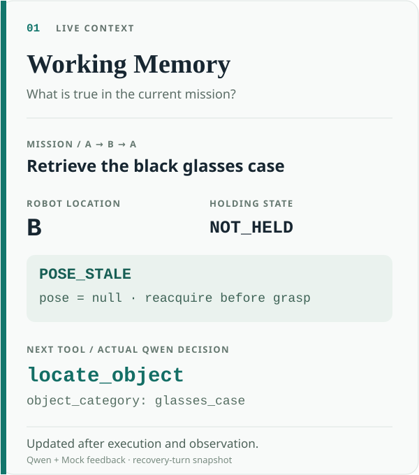
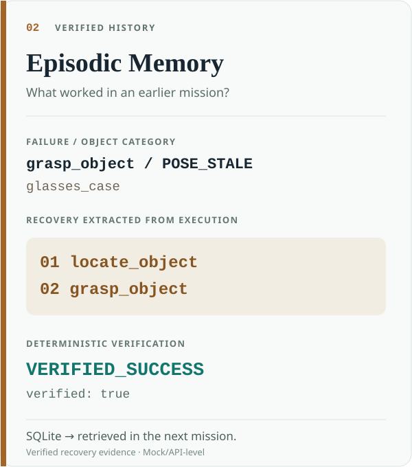
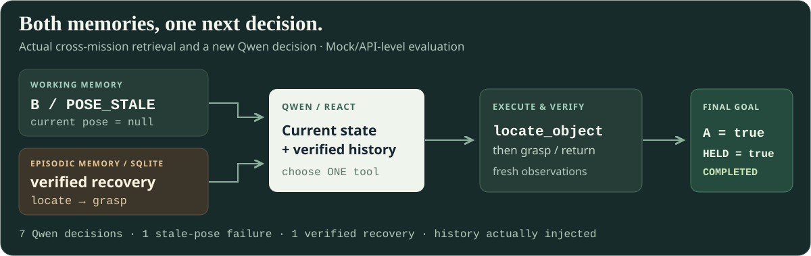

# ReAct + Memory Robot Agent

面向机器人长序列移动操作的 Agent 系统。使用 Qwen 理解自然语言指令和环境示意图，通过 ReAct 循环选择高层技能，并结合工作记忆、SQLite 经验记忆和执行反馈持续决策。

示例任务：**从 A 出发 → 到 B 寻找黑色眼镜盒 → 定位并抓取 → 携物返回 A**。


[查看原速视频](docs/media/project-demo.mp4)。以上为已有平台的演示录像；新 Agent 目前完成软件与 Mock 机器人联调，真机接入见下文。

## 工作方式

每轮决策执行一个技能，获得实际反馈后再决定下一步：

```text
指令 + 环境示意图
        ↓
   Qwen / ReAct ← 工作记忆 + SQLite 经验
        ↓
     高层技能
        ↓
  机器人执行与状态反馈
        ↓
 确定性验证 → 更新记忆 → 下一轮决策
```

| 技能 | 功能 |
| --- | --- |
| `navigate_to` | 导航到配置中的目标位置 |
| `locate_object` | RGB-D 采集、分割、FoundationPose 6D 位姿估计和坐标转换 |
| `grasp_object` | 预抓取、抓取、闭合夹爪和回撤 |
| `observe_robot_state` | 读取当前位置、机械臂状态和夹爪反馈 |

大模型只选择高层技能，不直接下发关节角、速度或底层硬件参数。任务完成必须同时验证**机器人返回 A**和**仍持有目标物体**。持物判断使用经过标定的实际夹爪宽度；反馈不足时保持 `UNKNOWN`。

## 双层 Memory 演示

两类记忆在**同一轮决策**中使用：Working Memory 保存当前任务事实；Episodic Memory 从 SQLite 取出历史已验证的恢复策略。

| Working Memory · 当前状态 | Episodic Memory · 历史经验 |
| :---: | :---: |
|  |  |

第一次任务出现 `POSE_STALE`，重新定位并抓取成功后，系统将恢复动作序列和验证证据写入 SQLite。下一次任务读取同一份历史经验；当机器人再次在 B 点遇到位姿失效，**当前状态与历史经验一起输入 Qwen**，实际返回的下一步是 `locate_object`。



本次演示使用真实 Qwen API 和 Mock 机器人：7 轮决策、1 次失败、1 次验证恢复，最终返回 A 且持有目标。卡片来自实际决策输入与 SQLite 验证记录的展示摘录；[查看 JSON 示例与验证字段](examples/memory_demo.json)。它验证了跨任务存储、检索和注入链路，不代表真机成功率或相对无 Memory 的性能提升。

经验目前以“失败类型 + 已验证恢复动作序列 + 验证证据”保存，不额外调用模型生成经验总结。JSON 用于结构化数据，SQLite 用于长期存储，SVG 用于 README 展示。

## 快速开始

使用独立的 **Python 3.10+** 环境。在仓库根目录安装：

```bash
python -m pip install -e .
python -m robot_agent demo --memory
```

默认使用 Mock 机器人和脚本化决策，无需硬件或 API Key。下面的示例注入一次位姿过期，Agent 会重新定位后继续任务：

```bash
python -m robot_agent demo --memory --fault POSE_STALE
```

执行记录保存在 `runtime/`，包括任务结果、JSONL 轨迹和 SQLite 记忆库。

## 接入 Qwen

将 `.env.example` 复制为 `.env`，填写自己的 API Key 和可用模型：

```dotenv
DASHSCOPE_API_KEY=your_api_key
QWEN_MODEL=qwen3-vl-plus
DASHSCOPE_BASE_URL=https://dashscope.aliyuncs.com/compatible-mode/v1
```

使用视觉模型理解示意图，并驱动 Mock 机器人执行完整流程：

```bash
python -m robot_agent demo --llm qwen --image examples/scene_ab.png --memory
```

可通过 `--image` 替换示意图，`--instruction` 指定指令。示例图片标注了 A、B、桌子和眼镜盒；真实导航位置由部署配置映射，图片不会直接生成底盘坐标。`.env` 已加入 Git 忽略列表。

## 接入真实机器人

`RobotBackend` 提供通用接口，其他平台实现相同协议即可接入。仓库保留了 RealMan 的导航、RGB-D、YOLO-seg、FoundationPose、坐标变换和抓取能力。

ROS Noetic、FoundationPose Conda 和 Agent Python 环境各自独立。先配置实际状态读取、停止接口、A/B 位置和夹爪宽度标定，再运行离线检查：

```bash
python -m robot_agent preflight --hardware-config config/hardware.example.yaml
```

示例配置保留待填写项，检查会列出缺失信息。真机动作需要显式启用；当前示例默认运行 Mock。完整接入步骤见[硬件部署说明](docs/HARDWARE_VALIDATION.md)。

## 代码结构

| 目录 | 内容 |
| --- | --- |
| `robot_agent/` | ReAct 主循环、工具、记忆、验证器和机器人适配器 |
| `navigation/` | 底盘导航接口与 ROS 桥接 |
| `vision_grasp/` | 相机、分割、位姿估计、坐标转换和抓取 |
| `config/` | 硬件配置模板、夹爪标定模板和导航目标 |
| `examples/` | 环境示意图与自定义 Backend 示例 |
| `docs/` | [系统架构](docs/SYSTEM_DESIGN.md)、[接口说明](docs/BACKEND_API.md)、硬件部署和演示媒体 |

新增 Agent 代码采用 [MIT 许可证](LICENSE-AGENT)。保留的第三方代码、驱动及演示媒体遵循各自授权，详见 [NOTICE.md](NOTICE.md)。
