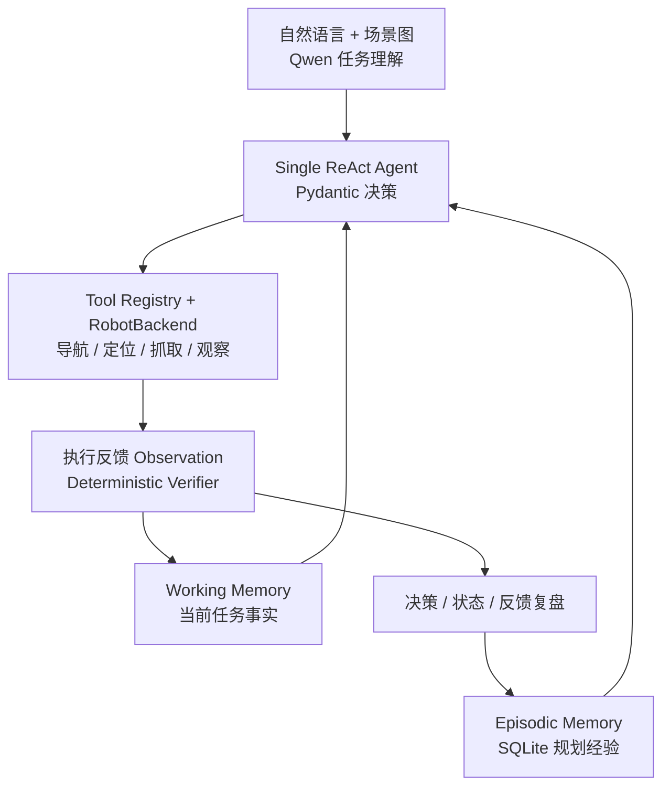

# ReAct + Memory Robot Agent

**面向长时序移动操作任务的具身 Agent 与记忆增强执行框架**

将自然语言指令与标注场景图像作为输入，由单个 ReAct Agent 逐轮调用机器人技能，完成跨地点导航、目标定位、抓取和携物返回。项目基于 RealMan 移动操作平台，连接 RGB-D、YOLO-seg、FoundationPose 与机械臂抓取能力，并通过 Working Memory 和 Episodic Memory 将当前状态、执行反馈与历史规划经验用于后续决策。

[任务示例](#任务示例) · [系统架构](#系统架构) · [双层-memory](#双层-memory) · [经验复盘演示](#经验复盘演示) · [快速开始](#快速开始) · [代码结构](#代码结构)


[观看原速视频](docs/media/project-demo.mp4)。视频展示已有机器人平台能力；新 Agent 的执行与记忆复用演示使用 Qwen API + Mock Backend。

## 项目关注什么

长时序移动操作中，一次成功的定位并不意味着后续仍可直接抓取：底盘移动、抓取失败或反馈变化，都可能使原有状态失效。系统需要持续判断“现在知道什么、下一步条件是否满足、失败后应该先补齐什么”，并将历史中遗漏的检查转化为后续规划约束。

本项目围绕这一过程实现：

- **逐轮 ReAct 决策**：每轮选择一个高层 Skill，执行后重新观察、验证和更新状态，再决定下一步。
- **双层 Memory**：Working Memory 维护实时任务事实；Episodic Memory 将历史失败复盘为适用条件、决策约束、经验和注意事项，供后续任务检索。
- **机器人技能编排**：通过结构化 Tool Calling 连接导航、视觉 6D 定位、机械臂抓取与状态反馈。
- **基于反馈的完成判断**：通过确定性 Verifier 检查动作结果和最终目标；模型提出 `FINISH` 后仍需独立验证。

## 任务示例

> 从 A 出发，到 B 点桌子上找到黑色眼镜盒，把它拿起并带回 A。

输入包括自然语言指令，以及标注 A、B、桌子和目标物体的场景示意图。当前版本以 **A→B→A、黑色眼镜盒** 为标准任务，任务中的位置标签映射到部署配置中的导航点。

| 阶段 | 系统执行的内容 | 进入后续步骤的依据 |
| --- | --- | --- |
| 理解任务 | Qwen 结合指令和场景图生成结构化任务描述 | 起点、取物位置、目标类别与位置映射通过校验 |
| A → B | 调用底盘导航能力到达取物区域 | 当前定位反馈确认到达 B |
| 定位眼镜盒 | RGB-D → 分割 Mask → FoundationPose 6D Pose → 相机到机械臂基座坐标变换 | 获得当前可用的目标位姿引用 |
| 抓取 | 预抓取、抓取、夹爪闭合和回撤 | 由实际夹爪反馈判断持物状态 |
| B → A | 持物返回起点，再读取状态 | 同时确认已到 A、仍持有目标 |

最终完成条件是 **`robot_at_A == true` 且 `object_held == true`**。只到达 A、只执行了闭合指令，或持物状态为 `UNKNOWN`，都不能报告完成。

## 系统架构



一次决策的执行路径是：**读取当前状态与相关经验 → 选择一个 Skill → 检查前置条件并执行 → 获取 Observation → 验证结果 → 更新 Memory → 下一轮决策**。

大模型负责高层技能选择与执行顺序。关节、底盘速度、夹爪控制参数及标定由机器人执行层管理；Agent 不直接生成这些低层控制量。每个动作的执行结果会影响下一轮输入，任务不依赖预先生成的完整动作列表。

### 四个高层 Tool

| Tool | 内部机器人能力 | 返回给 Agent 的关键信息 |
| --- | --- | --- |
| `navigate_to` | 调用已有底盘导航接口，前往任务允许的位置标签 | 到达位置、导航结果与实时状态 |
| `locate_object` | RGB-D 采集 → YOLO-seg Mask → FoundationPose 位置与姿态估计 → 坐标变换 | 当前目标的 `pose_id`、检测和定位结果 |
| `grasp_object` | 使用当前位姿完成预抓取、抓取、闭合及回撤 | 抓取执行结果、实际夹爪反馈与持物验证 |
| `observe_robot_state` | 读取导航、机械臂、运动稳定性与夹爪状态 | 用于更新当前事实、核清不确定动作的 Observation |

位姿随底盘移动或抓取尝试失效，抓取只能使用当前 Working Memory 中有效的 `pose_id`。持物状态采用 `HELD / NOT_HELD / UNKNOWN`，依赖经过标定的实际夹爪宽度反馈，而不是目标开合指令。

## 双层 Memory

两个 Memory 在同一轮决策中发挥不同作用：**Working Memory 回答当前事实是什么，Episodic Memory 提供在相似条件下应检查什么、避免什么、先做什么。** 以下 JSON 是精简展示结构，完整记录见 [实际演示输出](examples/memory_demo.json)。

<table>
<tr>
<th width="50%">Working Memory</th>
<th width="50%">Episodic Memory</th>
</tr>
<tr>
<td valign="top">
<p>维护任务进度、位置、物体与位姿、持物状态、动作、最新观察和错误。随执行反馈更新，并注入每轮决策。</p>
<pre lang="json">{
  "mission_status": "RUNNING",
  "current_location": "B",
  "pose": null,
  "grasp_state": "NOT_HELD",
  "last_error": null,
  "uncertain_action": null
}</pre>
</td>
<td valign="top">
<p>复盘历史决策、当时状态、失败反馈及后续过程，形成带适用条件和来源轮次的规划经验。</p>
<pre lang="json">{
  "applicability":
    "到达目标区域后，当前没有有效位姿",
  "decision_issue":
    "前置条件未改善时反复提出抓取",
  "planning_constraints": [
    "先取得本轮有效位姿，再安排抓取",
    "前置条件未改善时，不机械重试"
  ],
  "lesson":
    "利用反馈补齐条件，再决定下一步",
  "precautions": [
    "状态不明先观察，避免重复无效动作"
  ],
  "source_turns": [1, 2, 3, 4]
}</pre>
</td>
</tr>
</table>

### 经验如何形成和使用

同一 Agent 的模型接口在恢复成功或任务结束时，回看**决策 + 当时状态 + 执行反馈 + 后续过程**，总结规划中的漏检条件、动作顺序问题和无效重试。总结包含适用条件、规划约束、经验、注意事项与来源轮次，保存到 SQLite。

新任务开始及执行失败时，系统按任务、Skill、失败类型、物体类别检索相关经验，将约束与当前 Working Memory 一起注入 ReAct 上下文。Agent 需要先判断历史经验的适用条件是否满足，再决定下一步；历史位置、位姿或持物状态不会成为当前事实。

工具失败本身不能证明规划错误。运行时确认的决策问题，即使所在任务没有成功恢复，也可以留下负向规划约束；恢复成功的经验则单独保留验证证据。未完成总结的条目不进入复用上下文，模型总结也不能替代工具前置条件或 Verifier。

## 经验复盘演示

这个案例展示“历史中的决策问题如何转化为下一任务可用的约束”：

| 步骤 | 实际发生的过程 |
| --- | --- |
| **1. 历史失败** | 受控历史策略到达 B 后，没有取得当前有效位姿，却连续提出抓取。运行时拒绝提案，记录各轮决策、状态与失败反馈；这些提案未触发抓取执行。 |
| **2. Qwen 反思** | 将上述过程交给 Qwen，生成“没有有效位姿先定位”“前置条件未改善时不机械重试”等规划约束、经验与注意事项，并引用支持它们的历史轮次。 |
| **3. 跨任务回读** | 经验写入 SQLite；关闭并重新打开数据库后，新的任务检索到同一条历史记录，将其与当前 Working Memory 一起输入模型。 |
| **4. 后续决策** | 新任务在 B 点、`pose=null` 时，实际下一步为 `locate_object`；随后完成抓取、返回 A，并通过最终持物与位置验证。 |

[完整 JSON](examples/memory_demo.json) 保留 `prior_ep_id`、`injected_episode_ids`、凝练后的经验、决策输入摘录、`next_decision` 和最终验证结果，可核对经验是否真的被保存、检索和注入。[可运行脚本](examples/reflection_demo.py) 提供离线与 Qwen 两种模式。

已保存的演示使用真实 `qwen-plus` API，共 **1 次经验反思 + 5 轮后续决策**。历史错误提案为受控设置，后续机器人反馈来自 Mock Backend；它展示经验复用链路与实际动作选择，不将这一案例当作记忆带来成功率提升的对照实验。

## 快速开始

先创建并激活独立的 **Python 3.10+** 环境（步骤见 [运行文档](docs/QUICKSTART.md)），再执行下面的命令。演示不需要连接机器人。

```bash
git clone https://github.com/fanjiahui-charix/Long_sequence_tasks_for_realmanrobot.git
cd Long_sequence_tasks_for_realmanrobot
python -m pip install -e .

# 默认离线模式：脚本化决策 + Mock 机器人
python -m robot_agent demo --memory

# 注入一次位姿失效，观察重新定位、抓取和返航
python -m robot_agent demo --memory --fault POSE_STALE --output-dir runtime/recovery

# 历史决策失败 → 经验总结 → 下一任务检索与决策
python examples/reflection_demo.py --output-dir runtime/reflection
```

### 使用 Qwen API

将 [.env.example](.env.example) 复制为 `.env`，填写自己的 DashScope API Key。场景图理解需选择支持图像输入的 Qwen 模型；上方保存的 `qwen-plus` 复盘样例使用预验证任务描述进行反思与决策。配置步骤见 [运行文档](docs/QUICKSTART.md)。

```bash
# 自然语言 + 标注场景图：场景理解与逐轮执行
python -m robot_agent demo --llm qwen --image examples/scene_ab.png --memory --output-dir runtime/qwen

# 真实模型生成历史经验，并参与下一任务决策
python examples/reflection_demo.py --llm qwen --output-dir runtime/qwen-reflection
```

任务输出包括 `mission_report.json`、JSONL 执行轨迹和 SQLite 经验库。默认离线模式不调用 LLM；Qwen 模式需要 API Key。运行时数据和密钥不进入版本控制。

## 验证与实验

仓库的 [持续集成](https://github.com/fanjiahui-charix/Long_sequence_tasks_for_realmanrobot/actions/workflows/demo.yml) 在 Windows / Ubuntu、Python 3.10 / 3.12 上运行完整任务、故障恢复、经验持久化与跨任务注入演示。真实 Qwen 的反思与后续决策输出见上方 JSON 示例。

实验入口支持比较 **A：ReAct + Working Memory** 与 **B：ReAct + Working Memory + Episodic Memory**，并统计任务完成率、恢复成功率、误完成率、重复失败率、LLM 调用与延迟、总执行时间：

```bash
python -m robot_agent evaluate --repetitions 3 --output-dir runtime/evaluation
```

默认实验采用同一脚本策略和有序故障条件，属于 Mock/API-level Evaluation，用于检查闭环、故障处理与记忆链路。它与真实 LLM 的记忆效果对照、真实机器人的端到端验证分别评估。

## 代码结构

```text
robot_agent/
├── agent.py                 # 单 Agent ReAct 主循环
├── llm_adapter.py           # Qwen 接口与 Pydantic 结构化输出
├── state.py                 # Working Memory
├── memory/                  # SQLite、决策证据与经验凝练
├── tool_registry.py         # 四个高层工具及调用约定
├── executor.py              # 执行、超时与反馈处理
├── verifier.py              # 动作结果、持物及最终目标验证
├── backends/                # 通用 RobotBackend、Mock / RealMan
└── adapters/                # 导航、视觉、抓取及状态适配
navigation/                  # 已有底盘导航能力
vision_grasp/                # RGB-D、分割、FoundationPose、坐标与抓取
examples/                    # 场景图、复盘脚本与实际 JSON
config/                      # 通用硬件与标定配置模板
docs/                        # 运行、架构及硬件接入文档
```

阅读入口：[ReAct 主循环](robot_agent/agent.py) · [Working Memory](robot_agent/state.py) · [SQLite 记忆](robot_agent/memory/episodic.py) · [经验凝练](robot_agent/memory/consolidation.py) · [Verifier](robot_agent/verifier.py)

## 硬件接入与文档

通过通用 `RobotBackend` 接口接入不同平台；RealMan 适配复用已有导航、感知与抓取能力。ROS Noetic、FoundationPose Conda 与 Agent Python 环境分别保留，由适配层跨进程调用。

真实部署需要配置平台的导航点、状态与停止接口、视觉资源、相机外参及实际夹爪宽度标定。具体配置与部署前检查见下列文档：

| 文档 | 内容 |
| --- | --- |
| [QUICKSTART](docs/QUICKSTART.md) | 环境安装、Qwen API、任务与复盘演示 |
| [SYSTEM_DESIGN](docs/SYSTEM_DESIGN.md) | ReAct 循环、Memory、执行与验证机制 |
| [BACKEND_API](docs/BACKEND_API.md) | 通用机器人接口与反馈约定 |
| [HARDWARE_VALIDATION](docs/HARDWARE_VALIDATION.md) | 硬件适配事项、反馈标定与部署检查 |

## License

新增 Agent 贡献采用 [MIT License](LICENSE-AGENT)。FoundationPose、厂商驱动等第三方代码和媒体分别保留原有授权，见 [NOTICE](NOTICE.md)。
