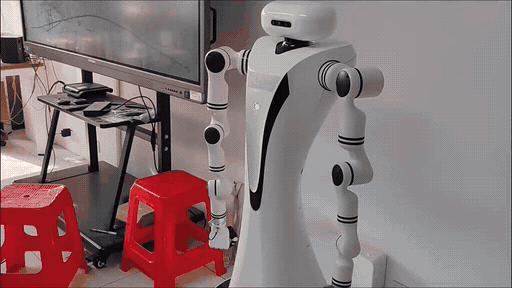

# 长时序移动操作 ReAct + Memory Robot Agent

[](https://github.com/fanjiahui-charix/Long_sequence_tasks_for_realmanrobot/actions/workflows/tests.yml)

[English](README.md) · [系统架构](docs/SYSTEM_DESIGN.md) · [通用接口](docs/BACKEND_API.md) · [实验结果](docs/EVALUATION.md)

新系统已替换旧 JSON Planner / AgentRuntime。单个 ReAct Agent 每轮选择一个高层 Skill，读取执行反馈，更新 Working Memory，并从 SQLite 检索已验证的恢复经验。任务为 **A → B 找黑色眼镜盒 → 抓取 → 持物返回 A**，不包含放置和松爪。

只有“当前位置验证为 A”与“目标仍被持有”同时成立，才能报告 COMPLETED。UNKNOWN、命令已发送、目标开合指令和 LLM 的完成声明都不能代替验证。

## 平台演示



[查看或下载原速视频（51 秒，MP4）](docs/media/project-demo.mp4)。

动图约 17 秒，以 3 倍速展示已有项目中的机器人平台与机械臂动作。视频对应的软件版本尚未与此次重构建立对应关系；新 Agent 的验证范围和结果见[实验报告](docs/EVALUATION.md)。

## 无硬件快速运行

Agent 使用独立的 **Python 3.10+** 环境；保留 ROS Noetic 系统 Python 与 FoundationPose Conda，不合并环境。

```bash
python -m pip install -r requirements-dev.txt
python -m pytest -q
python -m robot_agent demo --memory --fault POSE_STALE
python -m robot_agent evaluate --repetitions 3
```

演示注入一次位姿过期，重新定位后抓取并返回 A。结果、JSONL 轨迹和 SQLite 位于已忽略的 runtime/。脚本化 Mock 决策不是大模型，LLM Calls 明确记为 0。

## Qwen API + Mock 机器人

将 .env.example 复制为 .env，填写自己的 DashScope API Key 和账户可用模型。支持现有 Qwen 兼容 API，每次输出由 Pydantic 校验。图片理解需要视觉模型。不得提交 .env。

```bash
python -m robot_agent demo --llm qwen --image examples/scene_ab.png --memory --fault POSE_STALE --output-dir runtime/qwen-demo
python -m robot_agent evaluate --llm qwen --scenarios pose_stale,execution_unknown --repetitions 2 --output-dir runtime/qwen-evaluation
```

示例 PNG 是标注 A/B/桌子/眼镜盒的合成示意图。实际指令用 --instruction 输入，也可读取预验证的 --mission-file。图片不会直接生成可执行导航坐标，A/B 与真实 marker 的映射由部署配置提供。

## 通用接口与底层能力

RobotBackend 定义导航、定位、抓取、观察和取消接口，适配其他机器人无需改 Agent 核心。可选 RealMan 适配器保留现有导航、RGB-D、YOLO-seg、FoundationPose、TF 与抓取流程。核心新增依赖为 Pydantic，SQLite 使用标准库。

真实持物验证必须有实际测量宽度和标定。现有命令回显不能当实际反馈，缺失时保持 UNKNOWN。硬件配置模板故意留空，默认不能执行动作：

```bash
python -m robot_agent preflight --hardware-config config/hardware.example.yaml
```

[硬件适配清单](docs/HARDWARE_VALIDATION.md) 列出宽度/状态/停止接口、A/B 定位和相机时间同步等待确认事项。本次未执行真实机器人动作，也未改动原有相机外参或重新标定机械臂。

入口为 robot_agent/agent.py，通用协议为 robot_agent/backends/base.py。[审查记录](docs/AUDIT.md) 说明原始本地/GitHub 差异、保留文件和旧 Agent 删除范围。新增 Agent 代码按 MIT 开源，第三方保留各自许可证，详见 LICENSE-AGENT 与 NOTICE.md。
