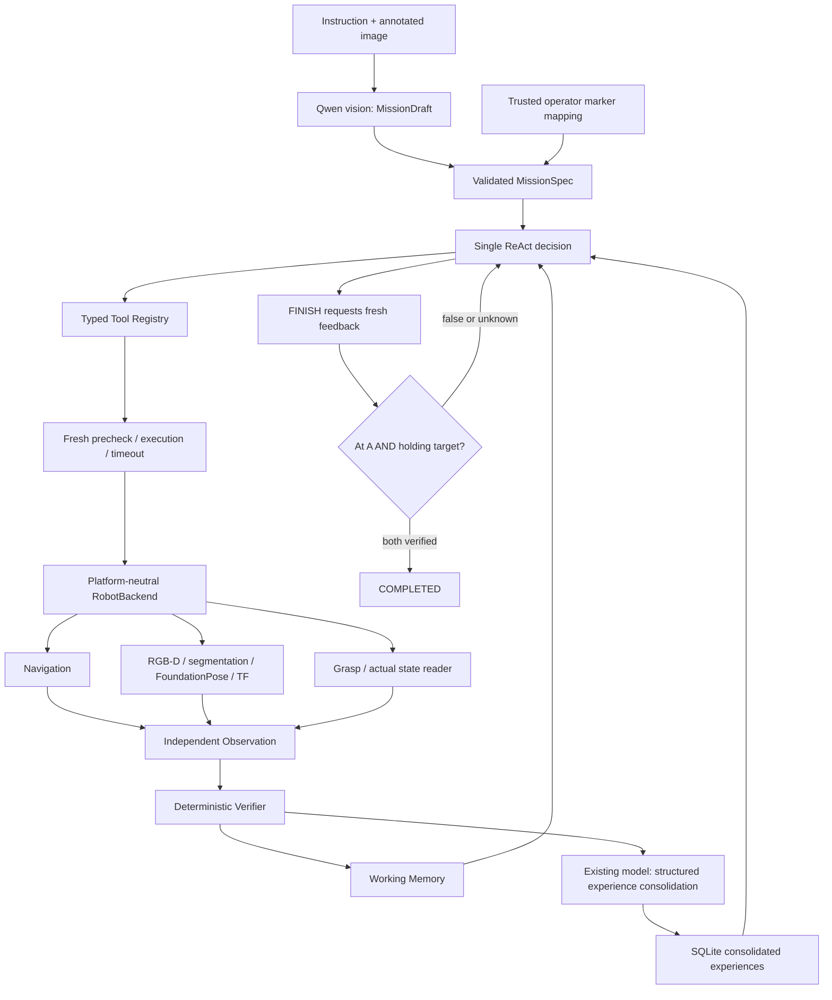

# ReAct + Memory Robot Agent V1

## Architecture

A single agent chooses one high-level action per turn. It never emits trajectories, joint angles, velocity, forces, calibration or executable commands. The old planner/runtime is removed without a compatibility path.

| Module | Responsibility |
|---|---|
| schemas.py / mission.py | Pydantic contracts, image-grounded mission facts, immutable success rules and trusted mapping |
| llm_adapter.py / prompts | Qwen-compatible HTTP, optional compatible/Ollama transports, server JSON mode and mandatory local schema validation |
| agent.py | One decision → one tool → observation → state/memory update → next decision |
| tool_registry.py / executor.py | Argument allowlists, preconditions, fresh execution-boundary telemetry, deadlines and cancellation |
| deadlines.py | Cancellation-preserving deadline waits across Python 3.10+, including simultaneous completion/cancel races |
| state.py | Current mission/location/object/pose/holding state, actions, errors, retries, motion epoch and uncertainty latch |
| verifier.py | Deterministic navigation, perception, measured-width and final-goal checks |
| memory/episodic.py | SQLite filtering, event/state persistence, recovery promotion and consolidated experience storage |
| memory/consolidation.py | Structured experience generation with the existing client, validation and failure handling |
| backends/base.py | RobotBackend protocol with no ROS/CUDA imports |
| adapters / hardware_worker.py | Optional existing RealMan capabilities across their existing interpreters |
| trace.py / evaluation.py | Structured traces, metrics and A/B API-level evaluation |

## Decisions and tools

AgentDecision is CALL_TOOL, FINISH, ABORT or REQUEST_HELP, with a short decision summary. A CALL_TOOL contains exactly one high-level call:

- navigate_to(target): trusted mission location label only, no arbitrary coordinates or speed.
- locate_object(object_category): new RGB-D, configured segmentation, FoundationPose and camera-to-base transformation; returns opaque pose_id.
- grasp_object(object_category, pose_reference): only the current verified pose_id; internally reuses home/pregrasp/grasp/close/retreat.
- observe_robot_state(): read-only current feedback; state is also collected automatically at skill boundaries.

No release/place tool exists. Every result is independently checked; backend success flags are insufficient.

A pose retains its original acquisition lower-bound timestamp. Model latency cannot refresh it. Base movement and grasp attempts invalidate it. Frame, current source location, object category and motion epoch must match; matrices must be finite rigid SE(3) transforms. Segmentation and FoundationPose scores must be finite before applying configured thresholds.

## Working Memory

A Pydantic object holds MissionSpec, mission status, location, detection/pose, held-target identity, actual width and HELD/NOT_HELD/UNKNOWN, completed/current actions, latest observation/error, retries, turn count, motion epoch and unresolved physical action. Each decision sees a bounded structured summary, rather than complete logs/images.

Only verified tool evidence installs a pose or held-target identity. Missing/stale observations invalidate previous physical claims. Grasp width must be measured, fresh, stable over distinct samples and, for HELD, observed after retreat using a category-specific calibration. Commanded opening is never evidence.

FINISH always acquires new feedback and checks current start location AND held target. UNKNOWN fails the final gate. The agent cannot write COMPLETED itself through a tool argument or model response.

## Episodic Memory

SQLite contains episodes, skill_events and missions. Episodes retain task/category/skill/failure, failure observation, actual recovery strategy, verification result and recovery-verified flag. They also contain an ExperienceSummary, its generation status/provider and any bounded generation-error code. Every skill event and mission snapshot is persisted when memory is enabled.

After a recovery is confirmed, or when a mission ends with unsummarized episodes, the same model client performs a separate Pydantic-validated summary step. ExperienceSummary records trigger, cause_hypothesis, cause_status, lesson and precautions. This is a function in the single Agent execution path, not a second Memory Agent. The offline scripted client supplies explicitly scripted summaries; only the Qwen client makes model requests.

Cause analysis and outcome verification have different meanings. cause_status is UNKNOWN or HYPOTHESIS, never CONFIRMED. A successful reacquisition after POSE_STALE validates a recovery outcome; it does not establish why a real pose became stale. A model cannot promote recovery verification, rewrite the observed recovery sequence or install a physical fact by generating a summary.

Retrieve at mission start and on failure, using bound SQL metadata filters by task type, category, skill and failure type. Inject at most three entries that have both a verified successful recovery and a completed structured summary. Failure analyses may remain stored without a verified recovery, but are not promoted into the validated-recovery context. Failed summary generation retains the underlying episode and does not fabricate experience text.

The prompt receives the relevant lesson, precautions and explicitly tentative cause analysis along with the observed recovery strategy. It excludes historical poses and raw instructions. Memory is advisory context; it cannot override current Working Memory, tool preconditions, independent observations or final-goal verification.

Failure episodes begin unverified. Promotion requires the original postconditions: navigation must reach its original target, and a carrying navigation must still hold the same target. Observing arrival while empty cannot verify recovery from object loss. Recovery may be saved before mission completion if it has independently succeeded.

## Execution uncertainty

Consolidation uses a 30-second deadline, at most six attempts per mission and at most two per episode (a recovery attempt plus one terminal retry). Invalid or unavailable model summaries are recorded as FAILED and excluded from retrieval. Model request counts and latency distinguish consolidation from action decisions. After a model wait the agent refreshes robot observations; if terminal consolidation followed a successful final check, it independently verifies the final goal again.

Physical skills run serially. Timeout, cancelled coroutine and terminated process do not establish that hardware stopped. A dispatched ambiguous action sets uncertain_action. Further physical calls are blocked until an explicit observation turn provides fresh settled navigation/arm feedback; grasp reconciliation also requires actual post-retreat holding evidence.

Cancellation attempts an independent configured stop and retains uncertainty until feedback resolves it. POSIX workers own a process group. Windows workers start suspended, join a kill-on-close Job, then resume; descendants remain owned if their parent exits. Killing workers never substitutes for robot state verification.

Three repeated same skill/failure events, a global turn bound, repeated invalid model output and rejected FINISH attempts lead to REQUEST_HELP. ABORT remains available.

## Environments and deployment

Agent: independent Python >=3.10, Pydantic, PyYAML and stdlib SQLite/HTTP/asyncio. ROS workers retain the ROS Noetic system interpreter. FoundationPose retains its own Conda interpreter and model dependencies. No ROS/CUDA/PyTorch upgrade or environment merge is performed.

Real motion requires explicit enablement and a passing confirmed config: actual width calibration, state/stop ports, waypoint tolerances, localization validity and sensor/TF timing. See HARDWARE_VALIDATION.md. Retained arm/camera parameters are inputs preserved from the original project, not new calibration evidence.
